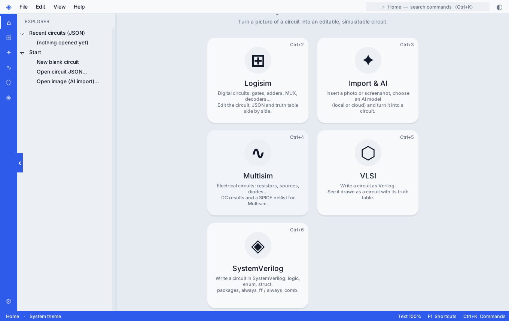
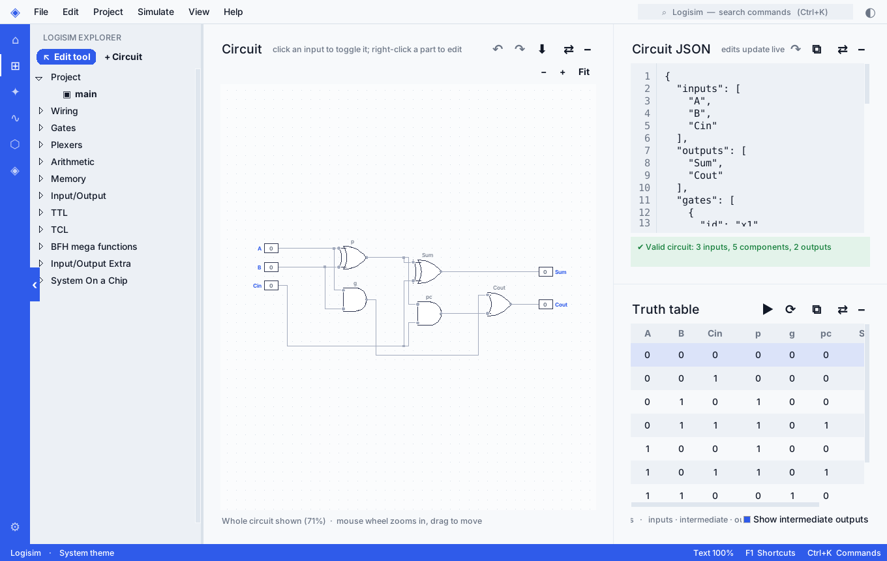
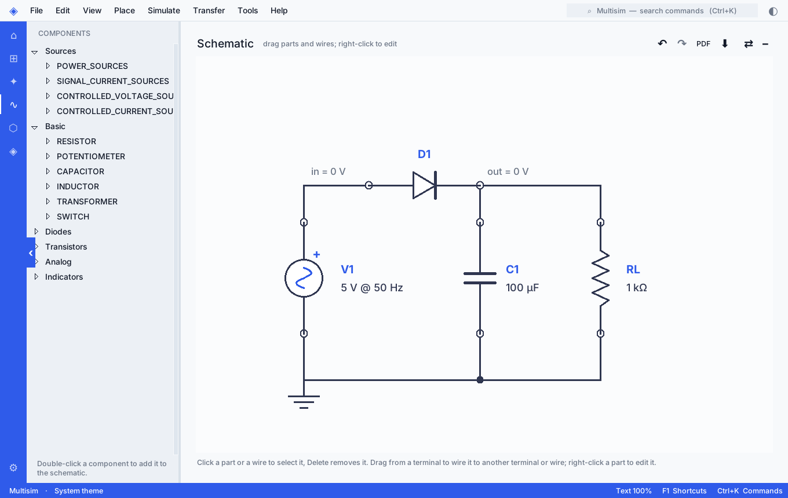
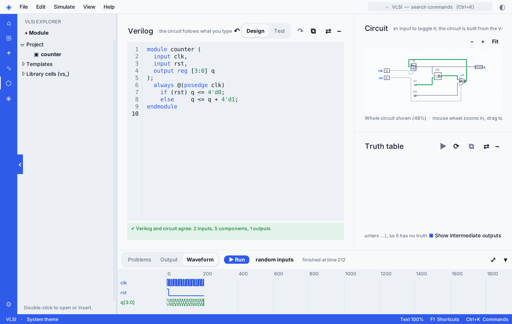
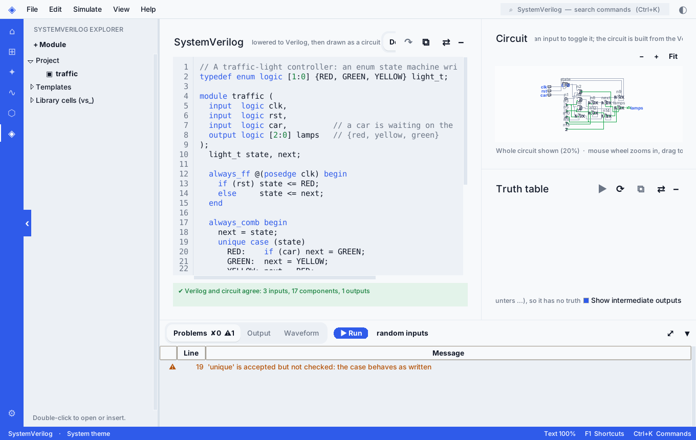

# VibeSimulation

**A free desktop app for designing and simulating circuits: Logisim-style digital logic, Multisim-style analog circuits, and Verilog / SystemVerilog, all in one window.**



Python and Tkinter, no cloud needed. Licensed under GPL-3.0. Version 1.3.0.

## What is in it

| | |
| --- | --- |
| **Logisim** | Gates, multiplexers, arithmetic, flip-flops, registers, RAM/ROM, sub-circuits. Edit the drawing, the JSON and the truth table side by side. Opens and saves Logisim `.circ` files. |
| **Multisim** | Resistors, capacitors, inductors, sources, diodes, BJTs, MOSFETs, JFETs, op-amps, transformers. DC, DC sweep, AC (phasors, Bode), transient, Thevenin/Norton, **parameter sweep, temperature sweep, Monte Carlo and noise**. A **function generator, oscilloscope and multimeter**. Exports a SPICE `.cir`. |
| **VLSI** | Write Verilog (loops, generate, functions, memories, tri-state) and see the circuit and truth table. A testbench simulator with waveforms. |
| **SystemVerilog** | `logic`, `always_ff` / `always_comb`, `enum`, packed `struct`, packages, `typedef`, `inside`, immediate `assert` and more, lowered to Verilog and drawn as a circuit. |
| **Import & AI** | Turn a photo or screenshot of a circuit into an editable one (bring your own model, local or cloud). |
| **And** | Examples gallery with tutorials, autosave and crash recovery, command palette (Ctrl+K), light and dark themes, PDF export. |

| Logisim | Multisim |
| --- | --- |
|  |  |
| **VLSI (Verilog)** | **SystemVerilog** |
|  |  |

## Install and run

You need **Python 3.9 or newer with Tk**. Nothing else is required (the only dependency, Pillow, is installed by pip).

### Windows

1. Install Python from [python.org/downloads](https://www.python.org/downloads/) and tick **Add python.exe to PATH** in the installer (Tk is included).
2. Download this repository (green **Code** button > **Download ZIP**, then unzip) or `git clone https://github.com/imthess/VibeSimulation.git`.
3. Double-click **`run_windows.bat`**. The first run creates a `.venv` and installs Pillow; after that it starts the app straight away.

Or from a terminal in the project folder (PowerShell):

```powershell
py -3 -m venv .venv
.venv\Scripts\activate
pip install .
vibesimulation
```

To build your own `VibeSimulation.exe`, double-click `build_windows.bat` (result: `dist\VibeSimulation\VibeSimulation.exe`). `packaging\windows\build_installer.bat` also makes a setup installer if [Inno Setup 6](https://jrsoftware.org/isdl.php) is installed.

### macOS

1. Install Python from [python.org](https://www.python.org/downloads/macos/) (Tk is included). If you use Homebrew Python instead, run `brew install python-tk` as well.
2. In Terminal:

```bash
git clone https://github.com/imthess/VibeSimulation.git
cd VibeSimulation
python3 -m venv .venv && source .venv/bin/activate
pip install .
vibesimulation
```

To build a `.app` and `.dmg` yourself, run `bash packaging/macos/build_dmg.sh` (needs the Xcode command line tools; signing is optional, see `packaging/SIGNING.md`). An unsigned app is blocked at first launch: right-click it and choose **Open**.

### Linux

**Prebuilt binary:** download `VibeSimulation-linux-x86_64.tar.gz` from the [Releases](../../releases) page, unpack it and run `VibeSimulation/VibeSimulation`.

**From source:**

```bash
sudo apt install python3-tk python3-venv      # Debian / Ubuntu; other distros: install Tk for Python
git clone https://github.com/imthess/VibeSimulation.git
cd VibeSimulation
python3 -m venv .venv && source .venv/bin/activate
pip install .
vibesimulation                                # or: python -m vibesimulation
```

> **Honest note:** only the Linux build has been built and tested. The Windows and macOS steps above use the same Python code and the scripts in `packaging/`, but nobody has run the `.exe` / `.dmg` builds yet, and there are no prebuilt Windows or macOS downloads. If something fails, please open an issue.

## First steps

1. Open **Help > Examples gallery** and pick an example; each has a short tutorial.
2. Press **Ctrl+K** to search every command. **Ctrl+1 to Ctrl+6** switch workspace.
3. In **VLSI** or **SystemVerilog**, click a line of code: the part it made is highlighted in the circuit. Press **Run** for a testbench.

## Honest limits

- Results are checked against closed-form answers, against ngspice (analog parts, see `dev/ngtest*.py`) and against Icarus Verilog (Verilog and SystemVerilog, `dev/vtest_*.py`, `dev/svtest.py`). They have **not** been compared with NI Multisim or a commercial HDL simulator.
- SystemVerilog covers the synthesizable core, not the whole language (no interfaces, classes, concurrent assertions). The list is in the [manual](docs/MANUAL.md#systemverilog-section-rail-item-systemverilog-ctrl6).
- Noise analysis has no flicker noise; op-amps are noiseless.

## Documentation

- [docs/MANUAL.md](docs/MANUAL.md): every feature, the file map and the design patterns used.
- [CHANGELOG.md](CHANGELOG.md): what changed in each version.
- [CONTRIBUTING.md](CONTRIBUTING.md): how to run the tests and add a part, an example or a SystemVerilog feature.

## Project layout

```text
src/vibesimulation/   the program (core, components, analog, verilog, systemverilog, vlsi, ui, product ...)
dev/                  tests and checks (see CONTRIBUTING.md)
packaging/            icons, PyInstaller build, Windows / macOS installer files
docs/                 manual and screenshots
```

## License

GPL-3.0, see [LICENSE](LICENSE). Logisim is a trademark of its authors; VibeSimulation reads and writes its `.circ` files but contains no Logisim code. Multisim is a trademark of NI; this project is not affiliated with NI.
