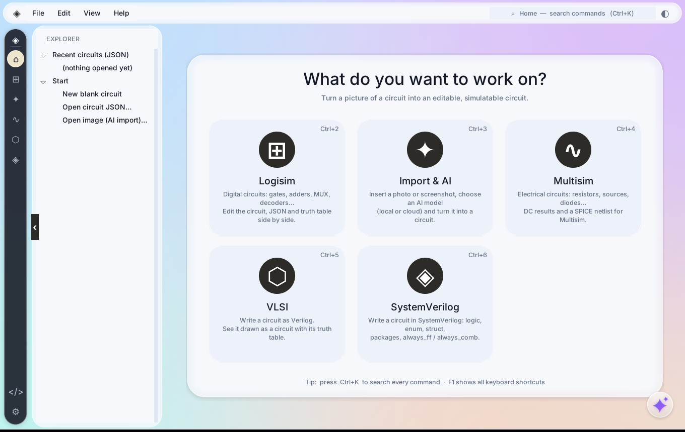
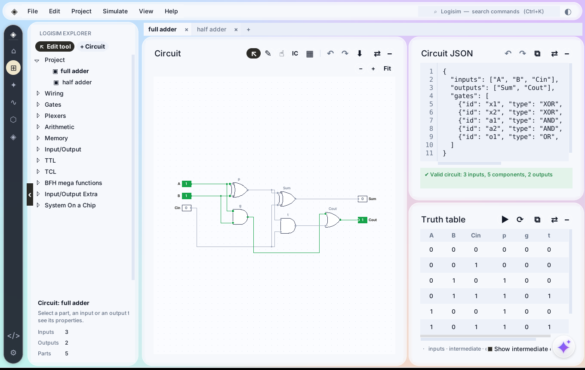
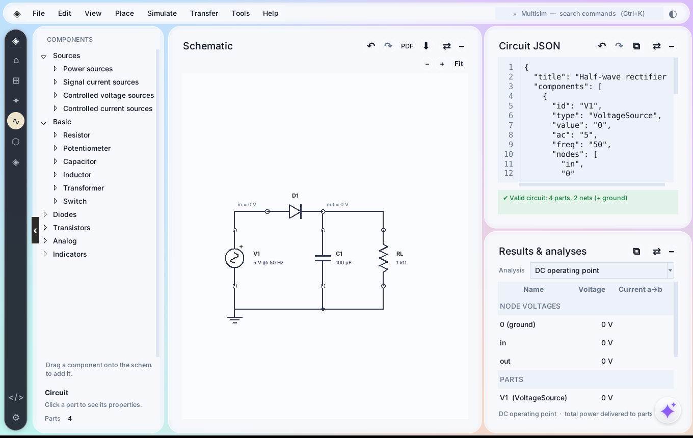
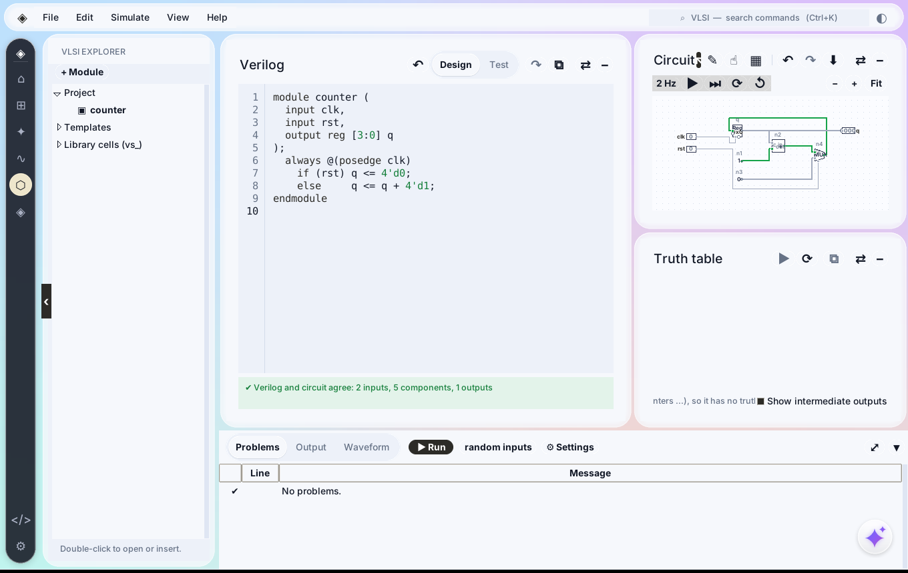
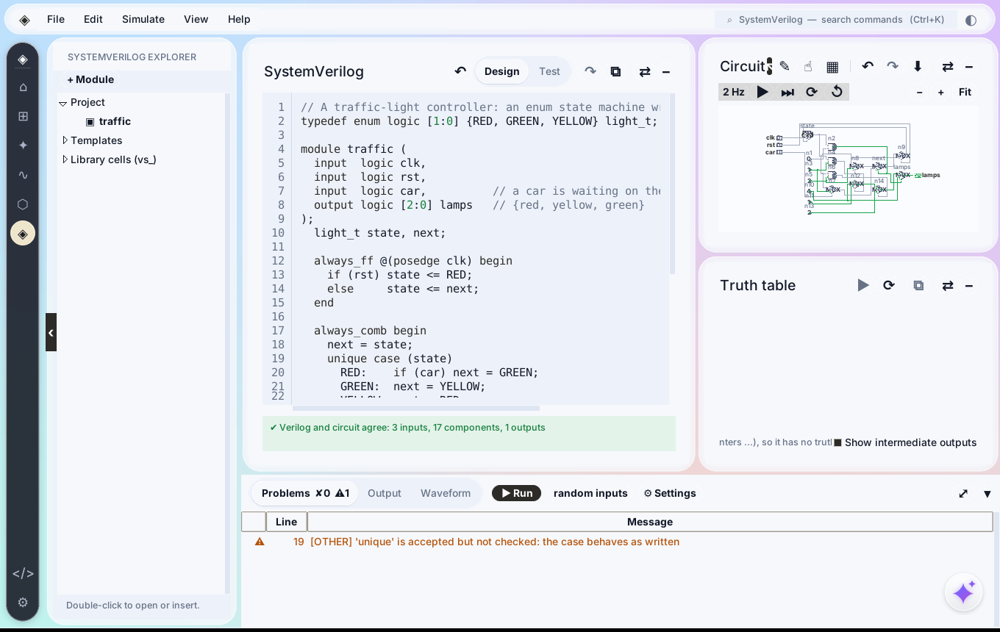
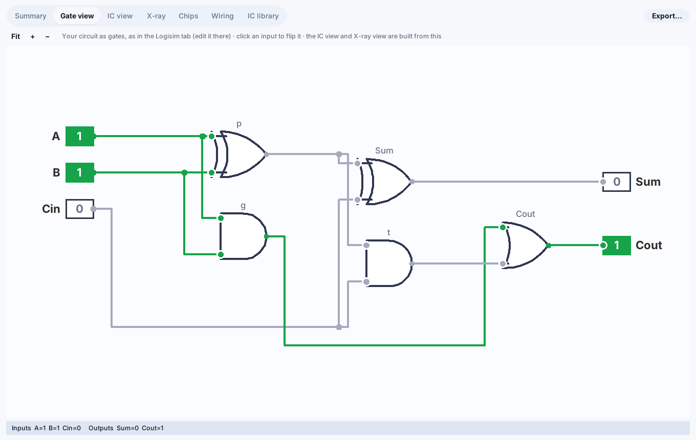
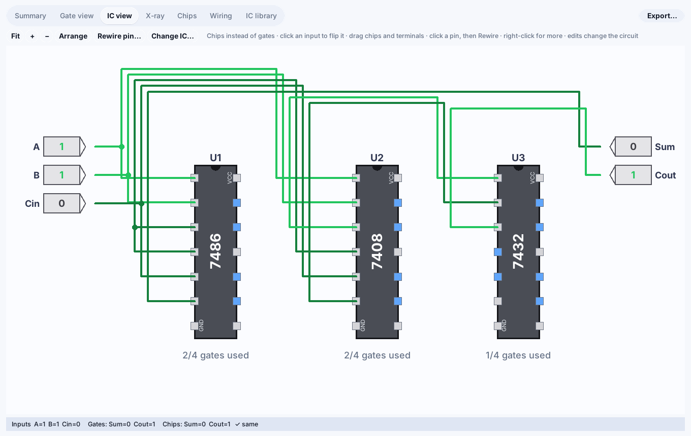
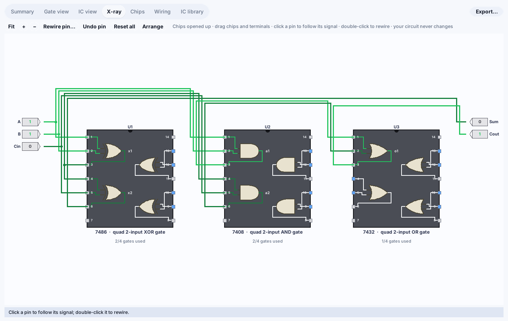

# VibeSimulation

**Design and simulate digital logic, analog circuits and Verilog / SystemVerilog in one free desktop application.**

[](../../releases)
[](LICENSE)




VibeSimulation is written in Python and Tkinter and runs entirely on your computer; no cloud account is required. Version **1.4.0**.

## Features

| Workspace         | Capabilities                                                                                                                                                                                                                                                                                                                                  |
| ----------------- | --------------------------------------------------------------------------------------------------------------------------------------------------------------------------------------------------------------------------------------------------------------------------------------------------------------------------------------------- |
| **Logisim**       | Gates, multiplexers, arithmetic, flip-flops, registers, RAM/ROM and sub-circuits. The drawing, the JSON and the truth table are edited side by side and stay in sync. Several circuits open as tabs. Reads and writes Logisim `.circ` files. The **IC** window rebuilds any circuit from real 74xx chips (Gate view, IC view and X-ray view). |
| **Multisim**      | Resistors, capacitors, inductors, sources, diodes, BJTs, MOSFETs, JFETs, op-amps and transformers. DC, DC sweep, AC (phasors, Bode), transient, Thevenin/Norton, parameter sweep, temperature sweep, Monte Carlo and noise analysis. Function generator, oscilloscope and multimeter. Exports a SPICE `.cir` netlist and a PDF report.        |
| **VLSI**          | Verilog (loops, generate, functions, memories, tri-state) drawn as a circuit with its truth table, plus a testbench simulator with waveforms.                                                                                                                                                                                                 |
| **SystemVerilog** | `logic`, `always_ff` / `always_comb`, `enum`, packed `struct`, packages, `typedef`, `inside`, immediate `assert` and more, lowered to Verilog and drawn as a circuit.                                                                                                                                                                         |
| **Import & AI**   | Converts a photo or screenshot of a circuit into a Logisim or Multisim circuit, or into Verilog / SystemVerilog, using the model of your choice (local or cloud) and a built-in prompt for each target.                                                                                                                                       |
| **AI button**     | Available on every page except Import & AI (Ctrl+J). Describe a change and the circuit or code is edited for you; Undo restores the previous state.                                                                                                                                                                                           |
| **General**       | Examples gallery with tutorials, autosave and crash recovery, command palette (Ctrl+K), light and dark themes, PDF export, high-DPI support.                                                                                                                                                                                                  |

## Screenshots

| Logisim: circuit tabs, JSON and truth table | Multisim: schematic and analysis                |
| ------------------------------------------- | ----------------------------------------------- |
|          |            |
| **VLSI (Verilog)**                          | **SystemVerilog**                               |
|                |  |

### IC window: gates, chips and X-ray

Press **IC** in the Logisim circuit box to see the same circuit three ways.

| Gate view                             | IC view                             |
| ------------------------------------- | ----------------------------------- |
|  |  |



- **IC view** shows Logisim-style TTL chips, each with one VCC and one GND pin, wired automatically. It is fully editable: flip inputs, drag chips and terminals, **Rewire pin**, **Change IC** and **Arrange**. Edits change the real circuit, and every view updates at once.
- **X-ray view** shows the gates inside each chip, with unused gates in white, so every signal can be followed. Rewiring here never alters your circuit.
- **Summary** lists the Logisim parts of the circuit and the chips that replace them. Chips are always built one-to-one with the gates, so outputs always match.

## What's new in 1.4.0

- **Circuit tabs.** Projects and Logisim `.circ` files with several circuits open as tabs. **Download .circ** and **Save JSON** let you choose which circuits to include.
- **IC window** with Gate, IC and X-ray views (see above); TTL chips in imported `.circ` files are read as gates.
- **Crisp on every display.** Windows DPI awareness removes the blurry rendering; the window, side bar and tiles scale with the display. `VIBE_UI_SCALE=1.5` forces a scale.
- **Reliable text files.** Settings, saved keys and Trash information are always UTF-8.
- **AI providers.** OpenRouter connection test fixed; thinking models that exhaust their answer budget are retried once with a larger limit.
- **Layout.** The clock controls of a circuit now sit on their own row, so narrow panes no longer clip the title.

The full list is in the [changelog](CHANGELOG.md).

## Install and run

You need **Python 3.9 or newer with Tk**. Nothing else is required (the only dependency, Pillow, is installed by pip).

### Windows

1. Install Python from [python.org/downloads](https://www.python.org/downloads/) and tick **Add python.exe to PATH** in the installer (Tk is included).
2. Download this repository (green **Code** button > **Download ZIP**, then unzip) or `git clone https://github.com/imthess/VibeSimulation.git`.
3. Double-click **`run_windows.bat`**. The first run creates a `.venv` and installs Pillow; after that it starts the app straight away.

Or from a terminal in the project folder (PowerShell):

```powershell
py -3 -m venv .venv
.venv\Scripts\activate
pip install .
vibesimulation
```

To build your own `VibeSimulation.exe`, double-click `build_windows.bat` (result: `dist\VibeSimulation\VibeSimulation.exe`). `packaging\windows\build_installer.bat` also makes a setup installer if [Inno Setup 6](https://jrsoftware.org/isdl.php) is installed.

### macOS

1. Install Python from [python.org](https://www.python.org/downloads/macos/) (Tk is included). If you use Homebrew Python instead, run `brew install python-tk` as well.
2. In Terminal:

```bash
git clone https://github.com/imthess/VibeSimulation.git
cd VibeSimulation
python3 -m venv .venv && source .venv/bin/activate
pip install .
vibesimulation
```

To build a `.app` and `.dmg` yourself, run `bash packaging/macos/build_dmg.sh` (needs the Xcode command line tools; signing is optional, see `packaging/SIGNING.md`). An unsigned app is blocked at first launch: right-click it and choose **Open**.

### Linux

**Prebuilt binary:** download `VibeSimulation-linux.tar.gz` from the [Releases](../../releases) page, unpack it and run `VibeSimulation/VibeSimulation`.

**From source:**

```bash
sudo apt install python3-tk python3-venv      # Debian / Ubuntu; other distros: install Tk for Python
git clone https://github.com/imthess/VibeSimulation.git
cd VibeSimulation
python3 -m venv .venv && source .venv/bin/activate
pip install .
vibesimulation                                # or: python -m vibesimulation
```

> **Platform support:** the application is developed and tested on Linux. Windows and macOS use the same Python code and the build scripts in `packaging/`; prebuilt packages for all three systems are attached to each [release](../../releases) when it is published. If something does not work on your system, please [open an issue](../../issues).

## First steps

1. Open **Help > Examples gallery** and pick an example; each has a short tutorial.
2. Press **Ctrl+K** to search every command. **Ctrl+1 to Ctrl+6** switch workspace.
3. In **VLSI** or **SystemVerilog**, click a line of code: the part it made is highlighted in the circuit. Press **Run** for a testbench.

## Known limitations

- Results are checked against closed-form answers, against ngspice (analog parts, see `dev/ngtest*.py`) and against Icarus Verilog (Verilog and SystemVerilog, `dev/vtest_*.py`, `dev/svtest.py`). They have **not** been compared with NI Multisim or a commercial HDL simulator.
- SystemVerilog covers the synthesizable core, not the whole language (no interfaces, classes, concurrent assertions). The list is in the [manual](docs/MANUAL.md#systemverilog-section-rail-item-systemverilog-ctrl6).
- Noise analysis has no flicker noise; op-amps are noiseless.

## Documentation

- [docs/MANUAL.md](docs/MANUAL.md): every feature, the file map and the design patterns used.
- [CHANGELOG.md](CHANGELOG.md): what changed in each version.
- [CONTRIBUTING.md](CONTRIBUTING.md): how to run the tests and add a part, an example or a SystemVerilog feature.

## Project layout

```text
src/vibesimulation/
  workspaces/           one folder per tab, each split by role
    home/                 page.py  (the Home tab)
    logisim/              core/ components/ layout/ export/ imports/   (its own model, parts, drawing, files)  circuit/ json_view/ truth_table/ ic/ (74xx chips: gate, IC and X-ray views)
    multisim/             core/ analysis/ components/ layout/ export/ imports/   schematic/ json_view/ results/
    verilog/              core/ (language)  project/  export/  editor/  circuit/  truth_table/  simulation/
    systemverilog/        core/ (lowering, features/)  editor/
    ai_import/            core/ (providers, prompt, keys, scan, usage, compact answer)  imports/ (opens any file)  ui/ (import page, crop dialog)
    activity/             the </> tab: ui/ (live log page)  core/ (findings, system info)  export/ (.md / .pdf report)  tools/ (connection and model tests)
    settings/             page.py  registry.py  and one folder per setting:
                            appearance/<setting>/  general/<setting>/  logisim/<setting>/  multisim/<setting>/  ai_import/<setting>/
  ui/                   the window shell, shared by every tab
    window/               main_window  menubar  menus  commands  actions  context  dialogs  popup  pane_workspace
    navigation/           rail  sidebar  file_browser
    look/                 theme  shapes  glass  platform (DPI awareness, UI scale)
    controls/             widgets  canvas_renderer
    panels/               props_panel  palette_drag
    views/                base  code_view
    assistant/            the AI button and prompt bar: controller  fab  bar  backdrop  session  targets
  product/              About box, examples gallery, update check, crash recovery
  common/               the only code shared by several tabs: drawing interface, wire routing, PDF/PNG writers, the activity log (activity.py)
dev/                  tests and checks (see CONTRIBUTING.md)
packaging/            icons, PyInstaller build, Windows / macOS installer files
docs/                 manual and screenshots
```

## License

GPL-3.0, see [LICENSE](LICENSE). Logisim is a trademark of its authors; VibeSimulation reads and writes its `.circ` files but contains no Logisim code. Multisim is a trademark of NI; this project is not affiliated with NI.
