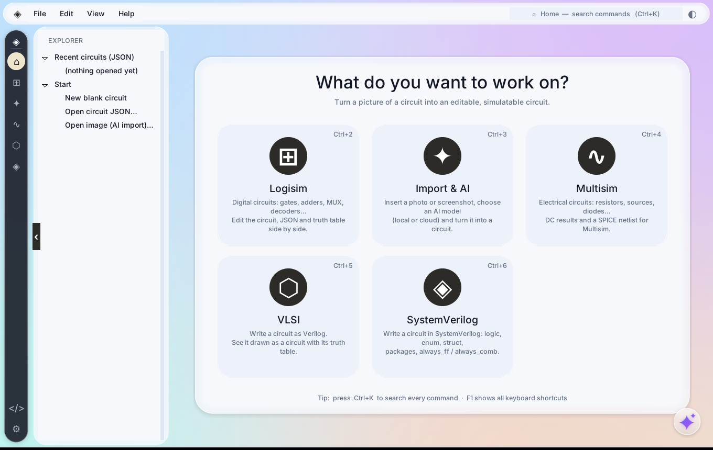
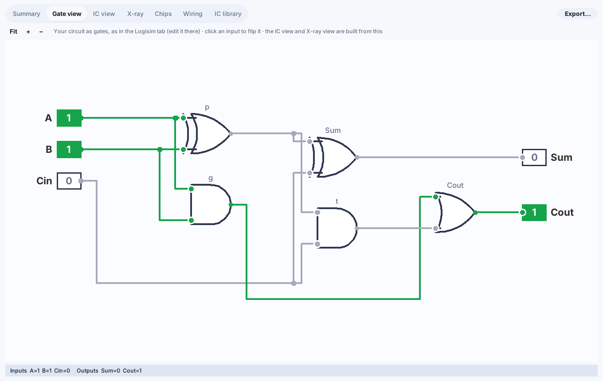
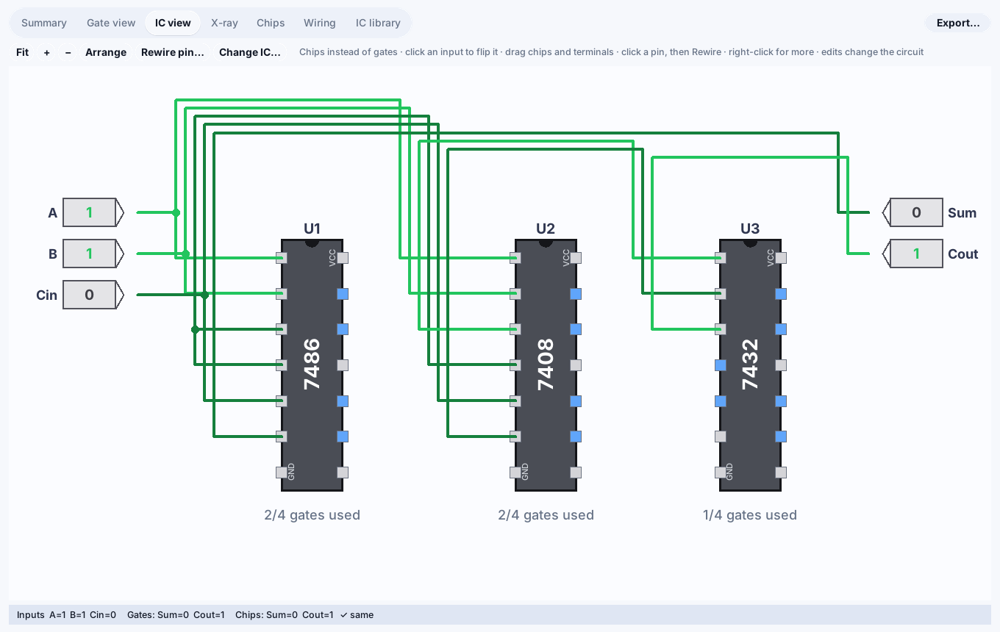
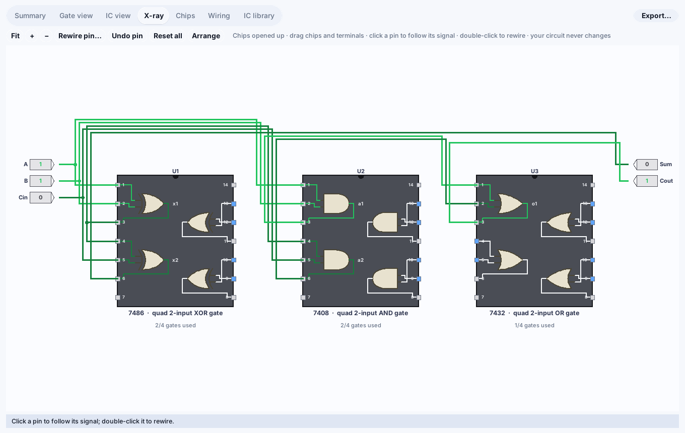
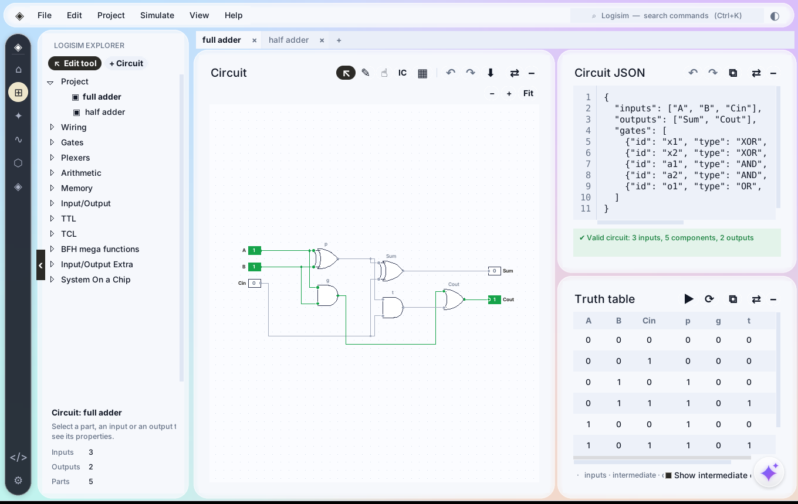

# VibeSimulation: full manual

> The short overview is the [README](../README.md). This file is the long reference: every feature, file and limit.

Turn a photo or screenshot of a digital circuit into an editable circuit, with a truth table, a PDF export and a Logisim `.circ` download.

## How the app is laid out
- **Activity bar (left)**: Home, Logisim, Import & AI, Multisim, VLSI, SystemVerilog (Ctrl+1 to Ctrl+6), the **</>** Activity page and Settings. The side bar next to it is the explorer of the current tab.
- **Home**: five tiles, one per workspace, plus recent files and a tip.
- **Top menu bar** (like VS Code): File, Edit, Project, Simulate, View, Help; Ctrl+K opens the command palette.
- **Logisim workspace**: circuit tabs on top, then three panes: Circuit (drawn with Logisim's own symbols; click inputs, right-click parts), Circuit JSON (editable, live) and Truth table, always in sync. The **IC** button opens the chip window (below).
- **AI button** (round, bottom right, Ctrl+J): describe a change and the circuit or code is edited for you.
- **Settings**: Appearance, General, Logisim, Multisim, AI & Import, About.

## Install
- **Ready-made app**: download the zip for your OS from the GitHub "Actions" run (or Releases) and unzip. Windows: run `VibeSimulation.exe`. macOS: open `VibeSimulation.app` (first time: right-click > Open). Linux: `./VibeSimulation`.
- **With Python 3.9+** (needs Tk; on Debian/Ubuntu `sudo apt install python3-tk`):
  `pip install .` then run `vibesimulation`  (or `python -m vibesimulation` with `PYTHONPATH=src`).
- **Build it yourself** for your OS: `python packaging/build.py` (output in `dist/`).
  Pushing a tag `v*` to GitHub builds Windows, macOS and Linux automatically (`.github/workflows/build.yml`).

## VLSI section (Verilog)
A separate page on the activity bar (hexagon icon, Ctrl+5) with three panes: **1 Verilog, 2 Circuit, 3 Truth table**. It has its own document and its own list of circuits, so nothing is shared with Logisim: Logisim keeps only Circuit, JSON and Truth table.

| Where (under `workspaces/verilog/`) | File | What it does |
|---|---|---|
| `.` | `workspace.py`, `actions.py`, `menus.py` | the page (three swappable/hideable panes plus the bottom dock), open/save `.v`, the page's own menus |
| `simulation/` | `dock.py`, `problems_tab.py`, `output_tab.py` | bottom panel: Problems, Output, Run |
| | `waveform_tab.py` | Waveform: radix, cursors A / B, signal list, zoom, **Save VCD** |
| | `sim_dialog.py` | **Simulation settings** window (top module, standard, -D, -I, timescale, limits, warnings off) and the equivalent iverilog / Verilator / xsim command lines |
| `editor/` | `verilog_box.py`, `highlight.py` | pane 1: the editor (compiles after a pause, red error lines, syntax colours) |
| | `side_panel.py`, `templates.py` | explorer: modules, snippet templates, `vs_` library cells (double-click to insert) |
| `circuit/` | `circuit_box.py` | pane 2: the circuit drawn from the Verilog; logic edits are refused (edit the Verilog), moving parts is allowed |
| `truth_table/` | `truth_table_box.py` | pane 3 |
| `project/` | `document.py` | `VlsiDocument`: what the page edits (Facade) |
| | `compiler.py`, `snapshots.py`, `samples.py` | text -> circuits; remembers the typed text; starter design |
| | `simulation.py`, `simsettings.py` | the Run step, the settings object (and command lines) |
| `export/` | `emit.py`, `writer.py`, `vcd.py` | circuit -> Verilog text, saving files, VCD waveform dump |
| `core/` | `lexer.py`, `preproc.py`, `parser.py`, `elab.py` | the language: tokens, `` `define `` / `` `ifdef `` / `` `include ``, syntax tree, tree -> circuit (IEEE 1364 width/sign rules) |
| | `lint.py`, `lintchecks.py`, `lintcodes.py` | style checks and Verilator-style warning codes |
| `../../ui/views/` | `code_view.py` | text editor base shared by the JSON and Verilog boxes |
Paths are inside `src/vibesimulation/workspaces/`, apart from `ui/` (the window shell, see "Shell and shared UI"). Each feature has its own file(s).

### Logisim workspace (`workspaces/logisim/`)
| File | What it does |
|---|---|
| `circuit/circuit_view.py` | **The Logisim circuit box**: drawing, zoom/pan, click inputs, **drag parts with the mouse**, right-click menus, Tidy, download icon |
| `json_view/json_box.py` | **The JSON text box**: red error lines, live parsing (built on `ui/views/code_view.py`, the editor base it shares with the VLSI Verilog box; also the base of Multisim's JSON box) |
| `truth_table/truth_table.py` | **The truth table**: rows, Play / Repeat, copy icon, "show intermediate outputs" |
| `circuit/parts_palette.py` | The **Parts** window (folders like Logisim's explorer) and the part Properties window |
| `circuit/parts_folders.py` | The folder list itself (Wiring, Gates, Plexers, Arithmetic, Memory, Input/Output, TTL, TCL, BFH, Input/Output Extra, System On a Chip). Edit this to move parts between folders |
| `ic/` | **IC view**: `catalog.py` (the 65 chips of Logisim's TTL library), `mapper.py` (circuit -> chips and pins), `session.py` (one per document: rewiring + live chip run), `schematic.py` (layout, wire routing and drawing of the IC view and the X-ray view; one VCC / GND tie per chip), `xray.py` (the gates inside a chip: used by the X-ray view and the Chips cards), `verify.py` (chip models and the circuit-vs-chips test), `breadboard.py` (wire list, pin cards), `report.py` (lists, guide), `view.py` (window) |
| `circuit/circuit_tabs.py` | The tab strip above the Logisim panes (several circuits open at once) |
| `core/`, `components/`, `layout/` | the circuit model and undo commands, one file per part, placement and drawing (see below) |
| `imports/logisim_in.py`, `export/logisim.py`, `export/pdf.py`, `export/png.py` | read `.circ`, write `.circ`, PDF report, PNG picture |
| `workspace.py` | Puts the three Logisim boxes side by side |

### Multisim workspace (`workspaces/multisim/`)
| File | What it does |
|---|---|
| `schematic/schematic_view.py` | **Box 1, the schematic**: drawing, drag parts, add/edit parts, PDF and `.cir` icons |
| `json_view/json_box.py` | **Box 2, the analog JSON** |
| `results/results_view.py` | **Box 3, results**: DC table, the analysis chooser and the **Show results for** picker (`results/focus.py`: choose parts / nets, every analysis follows) |
| `results/analysis_panel.py`, `ac_panels.py`, `more_panels.py` | DC sweep + Thevenin; phasors, Bode, transient; parameter / temperature sweeps, Monte Carlo, noise |
| `workspace.py` | Puts the three Multisim boxes side by side |
| `core/` | `netlist.py` (JSON, validation, SPICE text), `solver.py` (DC solver), `document.py`, `units.py` |
| `analysis/` | `ac.py`, `transient.py`, `noise.py`, `thermal.py`, `montecarlo.py`, `sweeps.py`, `measure.py`, `meter.py`, `scope.py`, `analysis.py` |
| `components/` | `basic.py` (R, C, L, sources ...), `active.py` (diodes, transistors, op-amps ...) |
| `layout/` | `schematic_layout.py` (placement and wire stretching), `painter.py` (draws a schematic on screen or PDF) |
| `imports/spice_in.py`, `export/pdf.py`, `export/png.py` | read a SPICE netlist; PDF report; PNG picture |

### AI import and file import (`workspaces/ai_import/`)
| File | What it does |
|---|---|
| `ui/import_view.py` | The whole Import & AI page: image import / paste, preview, model choice, Convert (locks the page while the AI works), open `.circ` / `.cir`, Open-in-Logisim / Open-in-Multisim buttons |
| `ui/import_page.py`, `ui/skin.py`, `ui/viewer.py` | Wraps the view into a full-width page |
| `core/autodetect.py` | Key -> provider -> live model list -> best model; retry with a live model when one is retired |
| `core/providers.py`, `core/prompt.py`, `core/key_detect.py`, `core/secrets.py` | Talking to Gemini, OpenRouter, Groq, Ollama, Claude, OpenAI, custom; the instructions sent with the picture |
| `workspaces/logisim/imports/logisim_in.py`, `workspaces/multisim/imports/spice_in.py` | Read Logisim `.circ` and SPICE `.cir` files into JSON (`ai_import/imports/__init__.py` picks the right reader for any file) |
| `workspaces/settings/ai_import/<setting>/` | One folder per AI & Import setting: models, default_convert_to, separate_ai, limit_reasoning, compact_answer, openrouter_pick, scan_* |
| `workspaces/ai_import/core/scan.py`, `compact.py`, `usage.py`, `tuning.py`, `profile.py` | Scan pipeline (Pillow only), short answer format, token log, the token-saving switches, the AI button's own AI |
| `workspaces/ai_import/ui/crop_dialog.py` | The draggable crop frame |
| `common/activity.py` | The shared activity log (thread safe, masks keys); every tab writes to it |
| `workspaces/activity/` | The Activity tab: `ui/` page, `core/` findings and system info, `export/` Markdown and PDF report, `tools/` connection and model tests |

### Settings (`workspaces/settings/`)
`page.py` is the Settings window (categories, search, rows). **Every setting is its own folder**, `<category>/<setting>/__init__.py`, which has one function `item(page)`:
`appearance/` (`theme`, `accent_colour`, `corner_style`, `glass_look`, `background`, `density`, `text_size`, `font`, `side_bar_size`, `side_bar_position`, `reduce_motion`, `high_contrast`, `status_bar`, `ai_button`, `reset_appearance`), `general/` (`auto_open`, `remember_window`, `pane_layout`, `recent_files`), `logisim/` (`table_bits`, `show_intermediate`, `play_speed`, `grid`), `multisim/` (`digits`), `ai_import/` (`models`). To add a setting: copy one of the folders and add `"<category>.<name>"` to `ORDER` in `registry.py`.

### Shell and shared UI (`ui/`)
| Folder | Files |
|---|---|
| `window/` | `main_window.py` (window, pages, undo), `menubar.py`, `menus.py`, `commands.py` (Ctrl+K list), `actions.py` (File/Download actions incl. both PDF exports), `context.py`, `dialogs.py`, `popup.py`, `pane_workspace.py` (swap/hide panes) |
| `navigation/` | `rail.py` (side bar), `sidebar.py`, `file_browser.py` (open/save window) |
| `look/` | `theme.py`, `shapes.py` (rounded shapes), `glass.py` (the glass background), `platform.py` (Windows DPI awareness, UI scale) |
| `controls/` | `widgets.py` (buttons, switches, cards ...), `canvas_renderer.py` |
| `panels/` | `props_panel.py`, `palette_drag.py` |
| `views/` | `base.py` (base class of every box), `code_view.py` (text editor base) |
| `assistant/` | `controller.py` (the AI button + bar), `fab.py` (round glass button), `bar.py` (text box, message, panel), `backdrop.py` (glass painting), `session.py` (one request), `targets.py` (what each workspace sends and accepts) |

The Home tab is `workspaces/home/page.py`. About box, examples gallery, update check and crash recovery are in `product/`.

### What each tab owns, and what is shared
| Folder | Role |
|---|---|
| `workspaces/logisim/core/` | digital circuit model, JSON, simulation, undo commands (`MovePart`, ...), `Document` |
| `workspaces/logisim/components/<library>/<part>.py` | one file per part (gates, wiring, plexers, arithmetic, io, memory) |
| `workspaces/logisim/layout/` | placement and wire routing (`engine.py` honours moved parts), `painter.py` |
| `workspaces/logisim/export/`, `imports/` | `.circ` writer and reader, PDF report, PNG picture |
| `workspaces/multisim/{core,analysis,components,layout,export,imports}/` | the same roles for analog circuits |
| `common/` | **the only shared code**: `render.py` (drawing interface), `events.py`, `routing.py` / `wire_edit.py` (wire geometry), `pdf_writer.py` / `png_writer.py` |

Verilog and SystemVerilog turn text into the Logisim circuit model, so they import from `workspaces/logisim/`; SystemVerilog imports from `workspaces/verilog/`.

To add a part: create a file in `workspaces/logisim/components/<library>/`, subclass `Component`, decorate with `@register`, and list it in `workspaces/logisim/circuit/parts_folders.py`.

## Moving parts
Drag a part in the Logisim circuit or the Multisim schematic. Like in Logisim, **the wires keep their shape**: only the wires on the part's pins stretch along (with a right-angle bend); every other wire stays where it is. It snaps to the grid and the wires follow. **None of this appears in the JSON**: positions, wire routes and orientation are *layout state* kept beside the JSON (see "Circuit and JSON" below). Undo/redo, `.circ`, `.cir` and PDF all follow. **Tidy** (or right-click > Put back in automatic place) removes the saved positions. A drop that would overlap another part, or leave wires that cannot be drawn, is refused. Input and output pins cannot be moved yet.

**Wires and pins work like in Logisim** (both workspaces, files `workspaces/logisim/circuit/dragging.py`, `workspaces/multisim/schematic/schematic_view.py`, `common/wire_edit.py`):
- drag a **piece** of wire sideways (joined pieces stretch along); drag a **corner or open end** to reshape the wire; **Shift+drag** on a wire adds a new bend;
- drag a part's **output pin** (or **Ctrl+drag** a circuit input) onto an input pin to connect them; in Multisim drag from one part **terminal** to another to join their nets;
- Logisim circuit **input and output pins** can be moved too (a plain click on an input still toggles it);
- **click a wire to select it, press Delete to remove it**; **click a part, press Delete to remove it** (wires that fed from it are unplugged, not left dangling). Right-click a wire: *Delete this piece of wire* or *Put wire back in automatic route*;
- **draw wires from anywhere, like Logisim**: drag from a part's output pin or a circuit input to an input pin; or press on the **middle of a wire that is not selected** and pull a new wire from that point. Drop on an input pin to connect it, or on empty space to leave a loose wire end there (it stays in the drawing; drag it onto a pin later);
- **drag the end of a wire off a gate's input pin**: drop on another pin to move the connection, on a wire or output to connect to that signal, or on empty space to disconnect it, leaving the wire end where you dropped it. To move a wire piece instead, **click it first** (it turns selected), then drag. A selected wire's loose end can be dropped on an input pin to connect it. Two different signals cannot be joined by a wire (Logisim shows an error there too). Pins may be left unconnected (a floating input reads `E` in Logisim). Strict checks (AI import) still reject floating inputs;
- Multisim works the same: select and Delete a part or a wire; drag a terminal onto another terminal or wire to move it there, onto empty space to detach it (the wire end stays where you drop it); pull from the middle of a wire onto a terminal or wire to join the two nets (a join that would short a part is refused). **A terminal left unconnected makes the circuit incomplete**: the status turns amber ("Incomplete circuit: R3 terminal 1"), the terminal gets a red ring and the results are flagged. Known limits: a dangling BJT collector or a dangling current source has no solution (the solver says so);
- in Multisim the ground wire moves and the ground symbol and net-name labels follow it.
Routes, positions and facing are layout state (not JSON). A route that stops fitting is ignored for that wire only.

## Look and feel (Settings > Appearance)
Dark icon rail on the left (Home, Logisim, Import & AI, Multisim, Settings), soft floating panels, graphite accent by default. Menus are drawn by the app and close on any outside click, Esc or window change.
Theme (Light / Dark / follow the system), 8 accent colours (default Blue) + a custom colour, corner style (Sharp / Rounded / Pill), density (Compact / Comfortable / Spacious), text size 85-150 %, font, reduce motion, high contrast, status bar on/off. Settings has a search box (Ctrl+F). Ctrl+K opens a command palette for every action; F1 lists all keyboard shortcuts (Ctrl+N/O/S/E/P, Ctrl+1-4, Ctrl+, Ctrl+= / - / 0, F11 ...). Alt+F / Alt+D / Alt+V open the menus. Tab moves between controls, Enter/Space press them, arrow keys change segmented controls and colour swatches.

## Open / Save dialog
The in-app file dialog works like the Ubuntu Files app: sidebar (Recent, Starred, Network, Trash, Home, Documents, Music, Pictures, Videos, Downloads, drives), back/forward/up, clickable path bar (click the empty part or Ctrl+L to type a path), sortable Name/Size/Modified columns, star column, list and icon view, search (Ctrl+F), new folder, rename (F2), move to Trash / restore / delete permanently / empty Trash, hidden files (Ctrl+H), properties, type-ahead. File > Open Recent lists the last files you opened. Network shows mounted network shares only. Trash on Windows/macOS is untested.

## Multisim (analog) workspace
**Parts:** Resistor, Capacitor, Inductor, Voltage source, Current source, Diode, **Zener** (extra `vz`, default 5.1 V), **LED**, **Switch** (click it to open/close; JSON `state`), **Ammeter**, **Voltmeter**, and the four **controlled sources** VCVS, VCCS, CCVS, CCCS (`value` = gain, `control` = two nets for voltage control or a source id for current control). Meters show their reading on the schematic. The schematic is a wired ladder (source on the left, series parts along the top rail, shunt parts down to a ground rail, junction dots); parts that share a net name are connected, net `0`/`GND` is ground.

**AC circuits.** A voltage or current source can carry an AC part next to its DC level: right-click > *Edit source…* sets `value` (DC), `ac` (peak amplitude), `freq` (Hz), `phase` (degrees) and `wave` (sine, square or triangle); it is drawn with a sine symbol and labelled, e.g. `2 V @ 1 kHz ∠30°`. The *Analysis* menu of the results pane then has:
- **AC: phasors, power** - every node voltage and part current as peak (or RMS) magnitude ∠ angle at one frequency, real power P, reactive power Q, apparent power, power factor (leading / lagging), the impedance seen by the source, and a phasor diagram of the rows you select.
- **AC: frequency response (Bode)** - magnitude (dB or linear) and phase of node voltages, part currents or the impedance seen by a source over a log or linear range; it reports the type (low-pass, high-pass, band-pass), the -3 dB points found by solving at the crossing (not by interpolating), centre frequency, bandwidth, Q and the roll-off in dB/decade. CSV export.
- **Transient (time)** - voltages and currents against time, starting from the DC operating point (capacitors and inductors with their DC state), trapezoidal or backward-Euler integration, diodes solved by Newton at every step (a step that fails to converge is halved); mean, RMS, min, max, peak-to-peak and frequency of any waveform over a time window you choose. CSV export.
- **Parameter sweep** - change one part's value or any numeric setting (a potentiometer's `pos`, an op-amp's `gain`, ...) step by step (linear or log) and plot what you measure: DC voltages / currents, the AC magnitude and phase at one frequency, or a transient statistic (final, peak, peak-to-peak, mean, RMS, max, min). CSV export; saved as `analysis.psweep`.
- **Temperature sweep** - the same measurements re-solved at each temperature. Resistors, capacitors and inductors use `tc1` / `tc2` (per °C and per °C², about 27 °C); diodes and transistors follow the saturation-current and thermal-voltage model, so a diode's forward voltage falls about 2 mV/K. The circuit's own temperature is `analysis.temp` (default 27 °C, results unchanged at 27 °C).
- **Monte Carlo** - many runs with random part values: give resistors, capacitors and inductors a `tol` (percent) or set a default tolerance in the panel; gaussian (sigma = tol / 3, clipped at tol) or uniform, with a seed so runs repeat. Mean, standard deviation, min, max, 5 % / 95 % percentiles, a histogram and, with pass limits, the yield. CSV export of every run.
- **Noise** - thermal noise of resistors, shot noise of diodes and transistors and channel noise of FETs at an output net over a frequency range: output spectral density, input-referred noise at a chosen source, RMS over the band and each part's share. Not included: flicker (1/f) noise; op-amps are treated as noiseless.

**Instruments** (Tools menu, each its own window that follows the circuit when it changes): a **function generator** (sine, square with adjustable duty, triangle, sawtooth; frequency, amplitude, DC offset, phase; it edits the source you pick), an **oscilloscope** (up to four channels with volts/div, offset, DC / AC / ground coupling, time/div, delay, edge trigger on any channel in auto or normal mode, and readings: Vpp, max, min, average, RMS, frequency) and a **multimeter** (DC / AC RMS voltage, DC / AC RMS current through a part, and resistance with the sources switched off, reading OL for an open circuit). The scope runs a transient simulation, so it shows what the simulator computes, not a live circuit; AC readings use the frequency of the strongest AC source.
Settings are saved in the JSON (`analysis.ac`, `analysis.tran`) and written to the `.cir` as `.ac` / `.tran`; sources are exported as `DC … AC … SIN(…)` or `PULSE(…)` and read back. Phase convention: sine-referenced, so only phase *differences* matter. Diodes, LEDs and Zeners enter the AC analysis as their small-signal conductance at the DC operating point. In AC and transient, a net still needs a DC path to ground (the same rule as SPICE). With the analysis menu on anything but the operating point the JSON pane steps aside to give the plots room (View > brings it back). An op-amp can be modelled with a VCVS of very high gain.

**What it computes (DC):** the operating point (node voltages, part currents and power) with Newton iteration, source stepping and gmin stepping for diode circuits; a **DC sweep** of any resistor or source (plot, CSV, saved in the JSON as `analysis.sweep`, written to the `.cir` as `.dc`); **Thevenin / Norton** equivalents seen by any part (linear circuits). Problems are reported in words: floating nets, voltage-source loops, a diode or LED driven past its limit, a controlled source pointing at nothing.

**Files:** download a SPICE netlist (.cir) that Multisim can import (File > Import > From SPICE netlist); the .cir importer reads R, C, L, V, I (DC, AC, SIN, and PULSE that is a square or triangle wave), D (a `.model` with `BV=` becomes a Zener), E, G, H, F and the `.dc`, `.ac` and `.tran` cards. Multisim's own `.ms14` format is proprietary and is neither read nor written.

**Verification:** the solver is checked against closed-form answers (RC, RLC resonance, Q, power factor) and, on hundreds of random circuits, against Kirchhoff's laws and power balance; the AC solver and the transient solver are checked against each other on random RLC networks (phasor = steady state of the time simulation, 63 circuits, agreement about 1e-4) and on diode circuits with a small signal. It has **not** been compared with Multisim or ngspice (neither is available where it was built), so treat numbers for strongly nonlinear circuits as unconfirmed.

**Transistors, op-amps, transformers.** Parts with three or four terminals: NPN and PNP (Ebers-Moll with Early effect, optional junction capacitances), NMOS and PMOS (level-1 square law, enhancement or depletion, optional gate capacitances), N and P JFET (Shichman-Hodges with gate junctions), IGBT (compact model: a MOS channel behind a forward drop, blocks reverse voltage, no tail current or latch-up), OpAmp (finite gain, output rails with soft limiting, single pole set by the gain-bandwidth product; supply pins are not drawn) and Transformer (primary inductance, turns ratio, coupling k). They work in the operating point, AC (small-signal, Bode, phasors) and transient analyses, and the operating table shows region, Vbe, Ic, beta, gm and so on. In the schematic these parts are placed in rows below the ladder and every pin carries a net-name label (joined by name, not by wires); drag a pin onto another to join nets, and use "Settings" to edit beta, threshold, rails and so on. A transformer's windings are 1 µΩ at DC, so the secondary needs its own ground reference. In transient, the op-amp pole is applied before the output limiter with backward Euler. SPICE export writes Q, M, J lines with `.model` cards, a transformer as two inductors plus `K`, an IGBT as an approximate N-channel MOSFET (its forward drop and reverse blocking are not exported), and the op-amp as a gain-only VCVS (rails and bandwidth are not exported). SPICE import reads Q, M, J lines with `.model` (NPN, PNP, NMOS, PMOS, NJF, PJF; W/L scale kp; CJE, CJC, CGSO, CGDO) and `K` couplings; op-amp subcircuits (X lines) are not read.

**Not included:** UJT, phototransistor, thyristors / SCR / TRIAC, Darlington pairs as one part (build them from two BJTs), MESFET, BJT transit-time (diffusion) capacitance, MOSFET body diode and body effect, level 2+ MOSFET models, three-phase sources, Fourier / THD analysis, mixed-signal parts, switches with a control input, PWL waveforms, AC analysis that uses a source's harmonic content. The models are verified against analytic results and against each other (Jacobians, KCL on random circuits, AC against transient), and against ngspice 42 (`dev/ngtest.py`, `dev/ngtest2.py`; needs `apt install ngspice`): operating points of BJT (with Early effect), PNP, NMOS (saturation and triode), PMOS, JFET and a CMOS inverter agree to within 0.1%; AC of a BJT amplifier from 10 Hz to 100 MHz agrees to 0.05% in magnitude and 0.01° in phase, MOSFET and JFET amplifiers agree exactly, and transient waveforms of a BJT amplifier and a transformer rectifier agree to within 0.1% of the amplitude. Not checked against Multisim itself. Capacitances are constant here; in SPICE the junction capacitances of a real model depend on the bias voltage (exported BJT and MOSFET files set MJE=MJC=0 and W=L=1 so ngspice uses the same constant values; a JFET's gate capacitance cannot be made constant in SPICE, so high-frequency JFET results differ from ngspice when cgs / cgd are set). The IGBT and the op-amp's rails and bandwidth have no SPICE equivalent and were not compared. Importing pictures of analog circuits is limited to the parts the AI prompt lists.

## Not supported yet
Floating-point parts, tri-state parts (controlled buffer/inverter, pull resistor, transistor, bidirectional RAM bus), Random, Keyboard/TTY/Joystick/LED bar/DOT matrix, floating (unknown) values, TTL/TCL/BFH/SoC libraries, RAM line/byte enables,  A 16-input priority encoder cannot be auto-routed. The half adder is Logisim's 1-bit Adder with Cin unconnected (Logisim has no separate half-adder part).

Dev checks (need Java + `dev/logisim.jar`): `dev/geotest.py`, `dev/semtest.py`, `dev/randtest.py`.

## JSON editor and big circuits
- The JSON box shows line numbers. When the text has an error, the line it belongs to turns red (number bar and background), so "line 20" is easy to find. The error messages themselves are unchanged.
- The circuit pane has Fit, + and - buttons; the mouse wheel zooms, dragging empty space moves the drawing, double-click empty space to fit it again.
- Layouts leave more room between columns and rows, wires keep a free grid line from each other where possible and never run along the top or bottom of a gate.

## Layout: activity bar, side bar, menu bar (VS Code style)
- **Menu bar** along the top: File, Edit, View, Help on every page, and per workspace the menus of the original program. Logisim: Project, Simulate. Multisim: Place, Simulate, Transfer, Tools. Alt+F / E / V / P / L / S / T / O / H open them; the search pill (Ctrl+K) runs any command.
- **Activity bar** (left icons): one flat bar in your accent colour (Settings > Appearance sets only its size and side). The small accent tab on the edge of the side panel hides or shows the **side panel** on every page; Settings' category list is the side panel there. Drag the panel's edge to resize it. Click the active icon or press Ctrl+B for the same. The gear opens a Manage menu (Settings, Command palette, theme).
- **Side bar, Logisim**: the explorer arranged like Logisim's, with **Edit tool** and **+ Circuit** buttons on top (the circuit tabs and tool buttons are no longer in the circuit pane): the project's circuits, then the library folders (Wiring, Gates, Plexers, Arithmetic, Memory, Input/Output, ...) with Logisim's own part order. Click a part, then click in the circuit to place it (Shift keeps the tool, Esc cancels). Double-click a circuit to open it. Parts Logisim has and we cannot simulate yet are listed greyed.
- The three panes (circuit, JSON, truth table) sit 1 px apart, flat like VS Code's editor groups.
- **Side bar, Multisim**: a component database arranged Group > Family > Component, as in Multisim's Component browser, plus Place > Component in the menu bar (Tidy is in Tools). The group and family names are from memory of Multisim, not copied from the program.
- **Settings** is a page like VS Code's: a search box on top ("N settings found"), a Commonly Used tab, then the categories; every row reads *Category: Label*. The activity bar style defaults to Docked; Settings > Appearance can still float it, move it to the right, or recolour it.
- Copy and download are icons in the pane headers: copy (the two-squares icon) for the JSON, truth table and DC results; download (the arrow icon) for the .circ (Logisim) and .cir (Multisim) files. Hover an icon to see its name.

## AI import: Logisim or Multisim
The AI is asked to say whether the picture is a logic circuit or an analog one. After Convert, the matching button at the bottom of the Import page (Open in Logisim / Open in Multisim) becomes clickable and takes you to that circuit; the other stays greyed out. Both go grey again when you load or paste a new image. Settings > General can make the app jump there automatically.

## Play the truth table
Two icons in the Truth table header: Play (▶) walks through every row from the first to the last, applying each row to the circuit so you can watch it; press it again (⏸) to stop. Repeat (⟳) makes it start again from the first row after the last one. How long each row stays is set in Settings > Logisim > Play speed (1, 2, 3 or 5 seconds). Clicking a row while it plays continues from that row. "Show intermediate outputs" moved to the bottom of the pane.

## Open circuits made in Logisim or Multisim
On the Import & AI page, "Open Logisim file (.circ)" reads a circuit you built in Logisim-evolution (the main circuit; gates of any size and direction, pins, constants, splitters, tunnels, multiplexers, adders and the other built-in parts). "Open Multisim file (.cir)" reads a SPICE netlist exported from Multisim (resistors, capacitors, inductors, diodes and Zeners, DC voltage and current sources, controlled sources, a `.dc` sweep). You get the JSON, the truth table or DC results, and the same "Open in Logisim / Open in Multisim" buttons light up. Multisim's own `.ms14` files cannot be read (closed format): export the circuit as a SPICE netlist first. Things that are not supported (sub-circuits, flip-flops and memories, transistors, AC sources ...) are listed in the message instead of being silently dropped.

### Activity (the </> icon above Settings)
Shows live what the program does in the background and helps to find out why something is slow or failing: a log (requests, seconds waited, tokens, errors), token usage, plain-words findings, and details (the last request and answer). **Test connection** and **Test model** time the service and the model without a picture. **Download .md / .pdf** saves a report (no API keys) you can send to someone who helps you. Shortcut: Ctrl+Shift+A.

### Saving tokens and cleaning the picture (Settings > AI & Import)
- **Scan on import**: the picture is cropped to the circuit, shadows are flattened and the page is made white with dark lines, at about 1200 px. Under the picture, **Scanned / Original** shows what is sent; **Adjust crop** lets you drag the frame yourself. Scan look, contrast, line strength, size, margin and "flatten shadows" are set in Settings.
- **Token usage and history** lists what every call really cost (tokens in / out / thinking). **Limit the AI's hidden thinking**, **Short answer format** and **OpenRouter model choice** reduce the cost; **Convert pictures to** lets you skip "Auto".
- **Use a different AI for the AI button** gives the button its own service and model (for example a free local model) while pictures use the one on the Import & AI page.

## Multisim PDF
Download > PDF (or the **PDF** icon on the schematic) writes the schematic on page 1, then the DC results (node voltages, every part's voltage, current and power) and the parts list.

## Circuit and JSON (independent, always in sync)
- The **JSON** holds only the logic: inputs, outputs, parts and their connections. It stays short and readable.
- The **circuit view** also remembers *layout state*: part positions, pin positions, hand-drawn wire routes and each part's orientation. It lives in `workspaces/logisim/core/layoutstate.py` and is held by the Document next to the JSON text (never inside it), is part of undo/redo, and is saved beside a saved JSON as `NAME.layout.json` (read back automatically on Open). Old files that still contain `"pos"`/`"wires"` are read and cleaned.
- Editing the JSON keeps the layout of every part/wire that still exists (matched by id / signal name). Editing the circuit rewrites the JSON.
- **Empty JSON is a valid blank circuit**: right-click empty space to add an input, output, gate or any part exactly where you clicked. A circuit may be half built (no outputs yet), like in Logisim.
- If the JSON has a typo, the circuit view keeps showing the last good version and says so; fix the JSON to continue.

## Orientation, selection, keys (Logisim-style)
Click a part to select it. **R** turns it clockwise, **L** counter-clockwise, **Delete** removes it, **Esc** unselects; right-click > Facing sets east/south/west/north. Orientation uses Logisim's own rotation (`workspaces/logisim/core/orient.py`: components are written once facing east and are turned by wrapping their pins, body and drawing) and is written to the `.circ` as the part's `facing`. Turning a part lets the router redraw its wires.

File map additions: `workspaces/logisim/core/layoutstate.py` (extract/apply/merge layout state), `workspaces/logisim/core/orient.py` (facing), `ui/window/actions.py` (sidecar read/write).

## Sequential logic (flip-flops, registers, counters, clock)
Parts: Wiring > **Clock**; Memory > **D / T / J-K / S-R Flip-Flop**, **Register**, **Counter**, **Shift Register** (`workspaces/logisim/components/memory/`, `…/wiring/clock.py`). Pin positions, defaults and behaviour follow Logisim-evolution (classic appearance).
- **Simulator:** `workspaces/logisim/core/sim.py`. Every sequential part has a state; after each change the circuit is calculated, every part that sees a clock edge (or an asynchronous Clear/Preset) takes its new state *at the same moment*, and this repeats until nothing changes (so ripple counters work). Feedback loops through flip-flops are allowed; a loop made only of gates is still an error. A loop that never settles shows "OSCILLATING".
- **Controls** (shown in the circuit header when the circuit has a clock/flip-flops): Tick half cycle (Ctrl+T), Tick full cycle (Ctrl+Shift+T), Run/Stop (Ctrl+K) at 1-32 Hz, Reset simulation (Ctrl+R). Clicking an input that feeds a clock pin also clocks the part. States are kept while you edit and are part of nothing in the JSON.
- **JSON** example: `{"id": "f", "type": "D Flip-Flop", "in": {"D": "qn", "Clk": "clk"}, "out": {"Q": "q", "Qn": "qn"}}`; optional pins (`Clr`, `Pre`, `En`, `Ld`, `UD`, `Sh`, ...) are only written when connected. Settings: `trigger` (rising/falling, D flip-flop and Register also high/low = latch), Register/Counter/Shift `width`, Counter `max`/`ongoal`, Shift `length`/`parallel`, Clock `high`/`low`/`phase`.
- **Checked against the real Logisim:** `dev/seqtest.py` exports 18 sequential circuits, runs them in `dev/logisim.jar` (`-tty table,halt`, which ticks the clocks) and compares every row with VibeSimulation: all identical. One known difference: Logisim 3.8.0 leaves the last parallel output of a Shift Register floating (a bug fixed later); VibeSimulation drives it.
- No truth table for such circuits (they depend on history).

## ROM, and importing sequential `.circ` files
- **ROM** (Memory > ROM): address bits 1-16, data bits 1-32. Contents are logic, so they are in the JSON: `"contents": {"0": 18, "1": 171}` (address: value, decimal or "0x.."; missing = 0; a plain list also works). Double-click the part (or right-click > Properties > Edit contents…) for a hex editor with *Open .hex/.txt* (Logisim's `v2.0 raw` files too). Contents are written to and read from `.circ` files. Checked against the real Logisim (a counter addressing a ROM, run in the jar).
- **Import:** `.circ` files with Clock, flip-flops, Register, Counter, Shift Register and ROM now load, in both Logisim looks (`classic` and the default `logisim_evolution`; pin positions of the latter are verified against the real Logisim by `dev/impseqtest.py`). Not yet: RAM, tunnels with sequential parts in sub-circuits, rotated sequential parts other than the Clock.
- Not supported yet: **RAM** (its default mode uses one two-way data bus, which this simulator cannot represent yet), Random, Button/Joystick/Keyboard/TTY, TTL, subcircuits.

## Gate view, IC view and X-ray view (Logisim)

*Gate view, IC view (editable, 74xx chips with one VCC and one GND pin each) and X-ray view (gates inside the chips; unused gates white; rewiring never changes the circuit).*
Press **IC** in the circuit box. The window shows the same circuit three ways: **Gate view** (gates, as in the Logisim tab), **IC view** (74xx chips instead of gates, drawn like Logisim's TTL parts, wired automatically) and **X-ray** (the same chips and wires with the gates inside each chip drawn). Every chip has exactly one VCC and one GND pin; inputs that must be held high or low are wired to that pin (red = +5 V, blue = GND). In the X-ray view click a pin to follow its signal and double-click it to rewire it; this changes only the chips, never the gate circuit or its JSON, and the Summary tab says whether the chips still match the gates. In the IC view, edits are real: drag chips, click a pin and Rewire pin… to change which signal a gate reads, or Change IC… to change a chip's gate type; the circuit, JSON and truth table follow. Changing the circuit or its JSON rebuilds all three views. A Logisim file that holds several unconnected circuits opens as several tabs, and Download .circ / Save JSON let you pick which tabs to include. Truth-table play drives the gates and the chips together.

## Several circuits and subcircuits

Tabs behave like browser tabs: open several circuits at once, close with the x, **+** adds a circuit. Opening a `.circ` with several unconnected circuits splits them into tabs. **Download .circ** and **Save JSON** ask which circuits to include.
A project can hold many circuits (tabs above the circuit view, **+ Circuit** adds one, right-click a tab to rename or delete it). Place a circuit inside another from
**Parts… > This project's circuits** (or right-click empty space > *Add circuit here*); its input/output pins become the part's pins. Double-click the part to open the circuit inside.
In JSON a subcircuit is `{"id": "u1", "type": "Circuit", "circuit": "half", "in": {"a": "A", "b": "B"}, "out": {"s": "S", "c": "C"}}` (pin names are the pin names of that circuit).
A project with several circuits is saved as `{"main": "name", "circuits": {"name": {...}, ...}}` (one circuit is still the plain format). Circuits that contain themselves are refused.
Simulation flattens the subcircuits (a counter inside a subcircuit counts, nested subcircuits work) and was compared with real Logisim row for row (`dev/subtest3.py`).
`.circ` export writes every circuit; import reads every circuit, in Logisim's classic subcircuit look exactly and in the newer look by reading the box width from where the wires end.
Unconnected subcircuit inputs read as 0 here (Logisim leaves them floating). Undo history is per circuit and starts again when you switch circuits.

## RAM, Button, editing several parts
RAM (Memory folder) is Logisim's default configuration: separate Din / Dout pins, optional async read, read-before/after-write, Clear pin, rising/falling/high/low trigger (`dev/seqtest.py`, `dev/ramtest.py`).
Contents start at 0; double-click the RAM while the circuit runs to read or edit them (hex editor, can load a hex file). Not supported: bidirectional bus, line/byte enables.
A Button in an imported `.circ` becomes an input pin. Editing: Ctrl+click adds a part to the selection, Shift+drag draws a selection rectangle, Ctrl+A selects all; drag one selected part to move all;
Ctrl+C / Ctrl+X / Ctrl+V copy, cut and paste (internal connections are kept, outside inputs stay connected to the same signals); Delete removes the selection.

## Display scaling and operating systems
- **Windows**: the app calls the DPI-awareness API before the window is created, so Windows no longer bitmap-stretches it (the old blurry look). Fonts follow the display scale; the default window size, side bar, rail, Home tiles and file dialog are scaled with it and the window is kept inside the screen.
- **Force a scale**: set the environment variable `VIBE_UI_SCALE` (0.75 to 3), e.g. `VIBE_UI_SCALE=1.5`. Code: `ui/look/platform.py` (`prepare`, `ui_scale`, `setup`, `fit_geometry`); `Theme.dp()` scales pixel sizes.
- **Text files** (settings, saved keys, Trash info) are UTF-8 on every OS.
- **macOS**: the middle and right mouse buttons are mapped for macOS Tk; keyboard shortcuts use Control, not Command.
- **Linux / Windows / macOS** mouse wheel, Recycle Bin / Trash and dark-mode detection are handled per OS.
- Tested: Linux under Xvfb at 100 %, 150 % and 200 % (`dev/guitest58.py`). Windows and macOS were not run by the author; reports are welcome.
